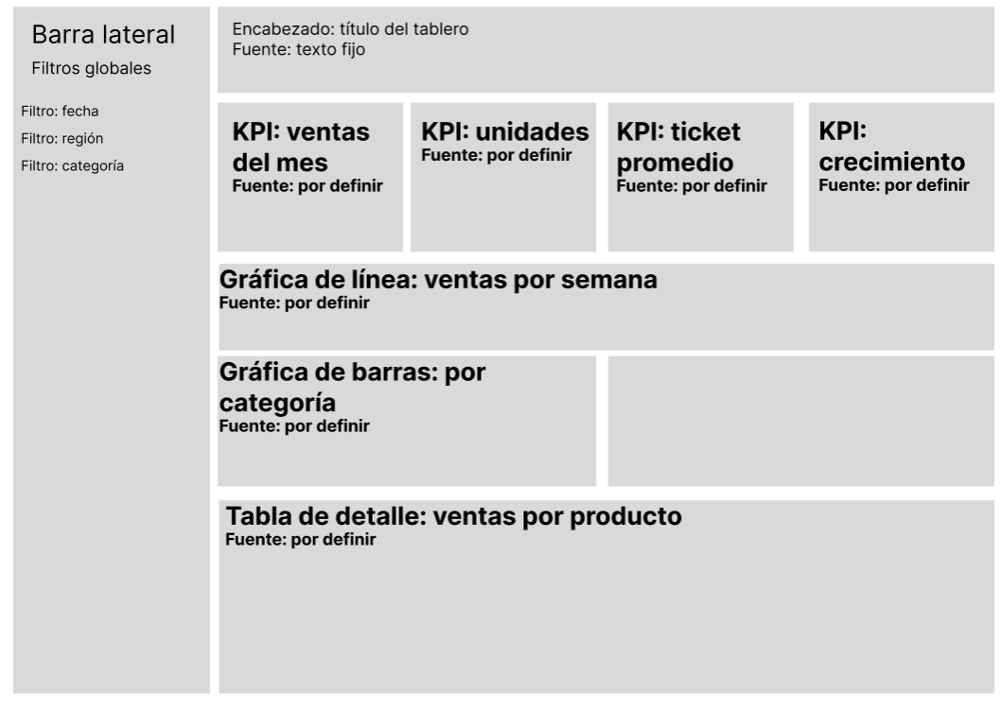
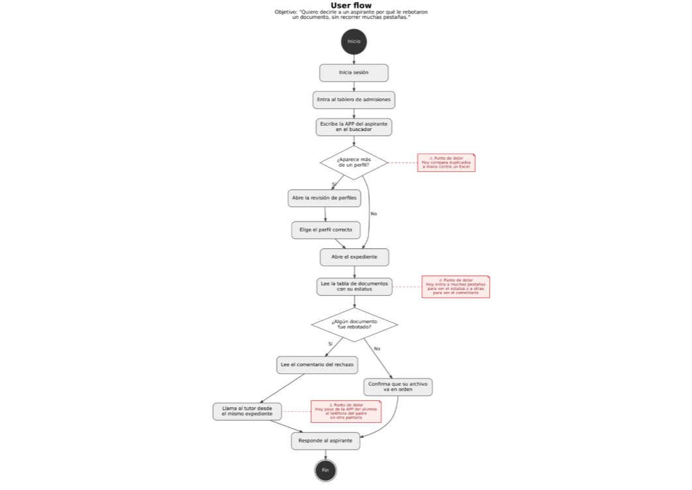
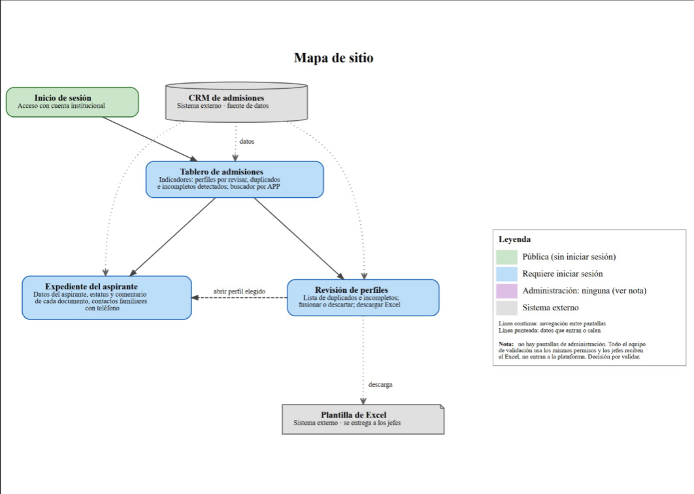

# Estructura de la plataforma - Equipo Análisis 4x4

## Archivo de Figma

Liga al archivo de Figma:(https://www.figma.com/design/ziE5szvPhEv7ankqAN6T3V/2.-User-flow?node-id=0-1&t=c03LNvLjuiJSC9KR-1)

El archivo contiene los sketches de las pantallas, el flujo de usuario y el mapa de sitio de la plataforma.

## Pantallas

### 1. Tablero principal
Muestra una vista general de los indicadores más importantes de la plataforma, permitiendo al usuario identificar información relevante de manera rápida.

### 2. Consulta de información
Permite al usuario consultar los registros almacenados en el sistema y revisar información específica de acuerdo con sus necesidades.

### 3. Detalle de información
Permite profundizar en los datos seleccionados y visualizar información más específica para facilitar su análisis.

## 1. Sketches

## 2. User flow

## 3. Sitemap

## Trazabilidad con UX

| Requerimiento de UX | Pantalla que lo atiende | Solución propuesta |
|---|---|---|
| Consultar información del sistema | Consulta de información | Visualización de registros y datos relevantes. |
| Identificar información importante | Tablero principal | Presentación de indicadores y resumen de información. |
| Profundizar en información específica | Detalle de información | Consulta detallada de los datos seleccionados. |

## Origen de los datos

| Elemento | Origen del dato |
|---|---|
| Indicadores del tablero | Datos del sistema de información. |
| Registros de consulta | Información almacenada en el sistema. |
| Detalle de información | Registros específicos seleccionados por el usuario. |

Los orígenes específicos de los datos, columnas y cálculos quedan por definir de acuerdo con la disponibilidad de la información del sistema.

## Decisiones y dudas

- Se busca mantener una estructura sencilla y fácil de navegar.
- Las pantallas se organizaron de acuerdo con las necesidades identificadas durante la investigación con el usuario.
- Se priorizó la consulta de información y la visualización de datos relevantes.
- Se evitaron pantallas innecesarias para mantener una navegación clara.
- Los orígenes específicos de los datos y algunos cálculos quedan por definir.
- La plataforma no distingue perfiles de usuario por el momento; esta decisión podrá revisarse conforme avance el proyecto.

## Wireframe de la pantalla principal

Se desarrolló el wireframe del dashboard de Lead Sales & Churn tomando como base el sketch realizado anteriormente. El principal cambio fue pasar de una representación general de la pantalla a una distribución más específica de los elementos que permiten analizar el comportamiento de los leads y el churn de clientes.

Se definió una jerarquía visual para facilitar la consulta de los indicadores principales, las gráficas y la información relacionada con el proceso de ventas y la retención de clientes.

Entre los cambios principales respecto al sketch se encuentran:
- Mayor organización de los indicadores KPI en tarjetas.
- Mejor distribución de las gráficas para facilitar la comparación de resultados.
- Separación visual entre la información de leads, ventas y churn.
- Mayor claridad en la ubicación de filtros y elementos de consulta.
- Organización de la información para que el usuario pueda identificar rápidamente los resultados más importantes.

El objetivo fue lograr una interfaz más clara, ordenada y fácil de interpretar, pensando en su futura implementación en Streamlit.

## Problemas que aparecieron con contenido real

Durante la construcción del wireframe se identificaron algunos problemas relacionados con la distribución y visualización de la información:

- **Textos que no cabían:** algunos nombres de indicadores y títulos de gráficas eran demasiado largos, por lo que fue necesario ajustar su tamaño y distribución.
- **Cifras que rompían las tarjetas:** los valores numéricos de los indicadores podían ocupar demasiado espacio, especialmente cuando incluían porcentajes o cantidades de varios dígitos.
- **Listas demasiado largas:** la información relacionada con los leads y los registros de clientes podía saturar la pantalla si se mostraba completa.
- **Gráficas con demasiada información:** fue necesario considerar qué datos eran realmente importantes para evitar visualizaciones difíciles de interpretar.
- **Jerarquía visual:** se revisó que los indicadores de mayor importancia, especialmente los relacionados con ventas y churn, destacaran sobre la información secundaria.

Estos problemas ayudaron a identificar ajustes necesarios para mejorar la legibilidad y evitar la saturación de información en el dashboard.

## Prueba de los cinco segundos

Se realizó una prueba de cinco segundos mostrando el dashboard a integrantes del otro equipo, con la intención de identificar qué información podían reconocer rápidamente sin recibir explicaciones previas.

**Comentarios simulados para documentar la prueba:**

- "Lo primero que identifico son los indicadores de ventas y churn, porque están en la parte superior y resaltan más que los demás elementos".
- "Entiendo que el dashboard sirve para analizar los leads y las ventas, pero me gustaría que fuera más evidente dónde puedo identificar los clientes que se están perdiendo".
- "Las tarjetas ayudan a entender rápidamente los resultados generales, aunque las gráficas necesitan títulos claros para saber qué estoy comparando".

**Ajustes propuestos a partir de los comentarios:**

- Mantener los indicadores KPI principales en una posición visible.
- Dar mayor claridad a los títulos y etiquetas de las gráficas.
- Diferenciar visualmente la información de ventas y la relacionada con churn.
- Facilitar la identificación de los indicadores más importantes desde el primer vistazo.

## Pendiente para mañana

- Convertir las pantallas restantes del sitemap en wireframes.
- Desarrollar el wireframe de la sección de análisis de leads.
- Desarrollar el wireframe de la sección de análisis de ventas.
- Desarrollar el wireframe de la sección de análisis de churn y retención de clientes.
- Revisar la consistencia visual entre las diferentes pantallas.
- Verificar que los filtros, indicadores y gráficas mantengan una distribución clara y funcional.
- Revisar los wireframes antes de comenzar con la implementación en Streamlit.